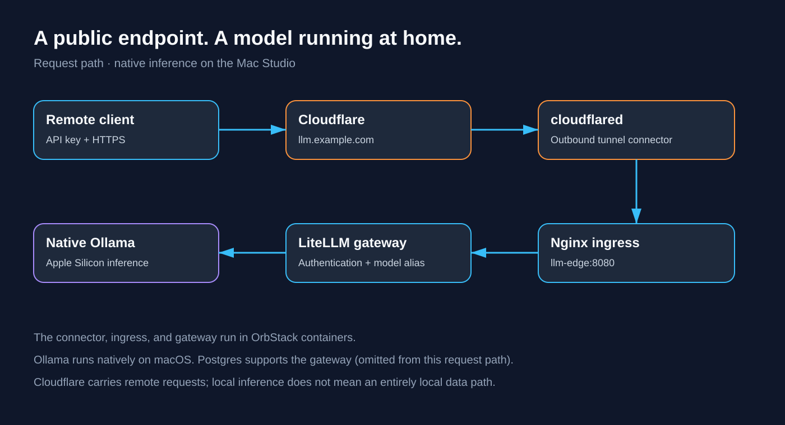
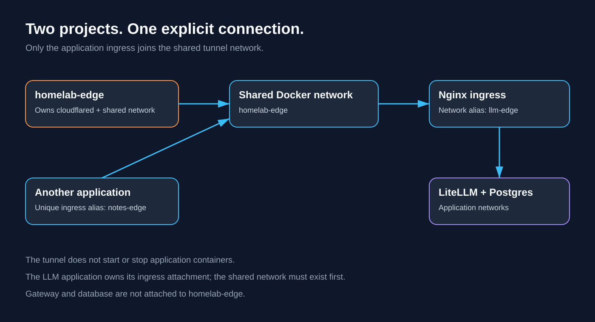

# My Mac Studio Became an LLM Endpoint. Here’s How I Connected It to the Internet.

*A developer guide to native Ollama, an API gateway, and a reusable Cloudflare Tunnel.*

Running a model on my Mac Studio was the easy part. Using it from another laptop was where the infrastructure started.

I wanted an endpoint like this:

```text
https://llm.example.com/v1
```

A coding client could use it with an API key, while inference stayed on the Mac at home. I also wanted to stop the LLM application independently, leaving the shared tunnel running so other applications could remain accessible remotely.

The result is two small projects: an LLM application and a shared tunnel. This guide walks through connecting them and exposing the local LLM through an authenticated HTTPS endpoint.

## 1. Decide what belongs on the Mac

Ollama runs natively on macOS, using the existing Apple Silicon inference installation. OrbStack runs the supporting containers: Nginx, LiteLLM, Postgres, and the Cloudflare connector.



*The browser-facing connection uses HTTPS. The connector reaches Nginx over a private Docker network; inference runs in native Ollama.*

Each component has one job:

| Component | Job |
| --- | --- |
| Cloudflare | Public HTTPS endpoint and routing |
| cloudflared | Outbound connection from the Mac to Cloudflare |
| Nginx | Restrict the publicly reachable API routes |
| LiteLLM | OpenAI-compatible API and client-key validation |
| Postgres | Persistent gateway data, including client-key records |
| Native Ollama | Run the selected local model |

Cloudflare Tunnel establishes outbound connections, so this route does not require opening an inbound router port. Follow the current [Cloudflare Tunnel setup guide](https://developers.cloudflare.com/tunnel/get-started/) if dashboard labels differ from the ones below.

“Local inference” describes where the model runs. Remote prompts and responses still pass through Cloudflare and the gateway. That matters when deciding what data to send.

## 2. Get the local API working first

This guide uses two sibling directories:

```text
projects/
├── homelab-edge/      # Shared connector and network
└── llm-inference/     # Nginx, LiteLLM, Postgres, model configuration
```

This guide uses [homelab-edge v0.1.0](https://github.com/AgenticFoundations/homelab-edge/releases/tag/v0.1.0) and [llm-inference v0.1.0](https://github.com/AgenticFoundations/llm-inference/releases/tag/v0.1.0). Both repositories currently require access.

To get the companion application, run this from your `projects` directory:

```bash
git clone --branch v0.1.0 --depth 1 https://github.com/AgenticFoundations/llm-inference.git
```

The application commands below refer to this companion `llm-inference` project; they are not commands provided by Ollama itself. If you already have a different local API, keep it and adapt its ingress hostname and port in step 5.

Before starting, have OrbStack, native Ollama, uv, and a suitable Python 3.12+ interpreter available. Use your existing Ollama installation. Choose an installed model that fits your Mac’s memory; there is no particular model required for tunnelling.

In my application, model tags and public aliases live in `config/models.json`. The client requests an alias such as `local-coder`; the gateway maps it to the installed Ollama model.

```bash
cd ../llm-inference
make setup
# Edit config/models.json to match your installed models.
make doctor
make up
```

`make setup` generates private credentials without starting services. `make up` starts the application containers and checks connectivity; it does not download or preload models. Container images may be downloaded on first startup.

One quick local check is enough here:

```bash
curl http://127.0.0.1:4080/healthz
# ok
```

The Nginx ingress permits `/healthz`, `GET /v1/models`, and `POST /v1/chat/completions`. Other paths, including gateway administration, return 404. Model discovery and inference require a client key. Keep those restrictions when attaching the ingress to the tunnel network.

## 3. Prepare DNS without transferring the domain

My domain was registered through Squarespace. I kept registration and renewal billing there and moved authoritative DNS to Cloudflare.

Those are separate responsibilities: the registrar handles registration; the DNS provider answers where each hostname goes.

For the standard Cloudflare full setup:

1. Add your root domain, such as `example.com`, using **Connect a domain**.
2. Select the Free DNS plan and scan existing records.
3. Compare the scan against the old provider’s complete record list.
4. Copy missing records, including MX, SPF, DKIM, verification records, and application subdomains.
5. Initially keep existing website A/CNAME records **DNS only** to avoid adding proxy behavior during the migration.
6. Follow the DNSSEC migration instructions, then replace the old nameservers at your registrar with the exact pair Cloudflare assigns.
7. Wait for Cloudflare to mark the domain active.

The scan missed several of my custom records. Treat it as a starting point, not a backup. Check forwarding-service requirements separately: copying an IP address does not define a redirect rule or an email destination.

Cloudflare documents the process in its [full DNS setup guide](https://developers.cloudflare.com/dns/zone-setups/full-setup/setup/). Verify the websites and email services you intend to keep before moving on.

## 4. Start one shared connector

The tunnel project is available at [homelab-edge v0.1.0](https://github.com/AgenticFoundations/homelab-edge/tree/v0.1.0). The repository is private at the time of this draft; cloning requires access.

From the `projects` directory:

```bash
git clone --branch v0.1.0 --depth 1 https://github.com/AgenticFoundations/homelab-edge.git
cd homelab-edge
make setup
```

In Cloudflare’s tunnel dashboard, create a cloudflared tunnel named `homelab-edge`. Depending on the dashboard, this appears under **Networking → Tunnels** or **Zero Trust → Networks → Connectors**.

Select the Docker instructions and copy the tunnel token into this project’s `.env`:

```dotenv
CLOUDFLARE_TUNNEL_TOKEN=YOUR_TUNNEL_TOKEN
EDGE_NETWORK=homelab-edge
```

Use the actual token, not the placeholder. Keep the file out of Git. The project restricts `.env` to owner read/write permissions.

I did not run the dashboard’s Homebrew or macOS service-install commands. The project already supplies the connector container:

```yaml
services:
  tunnel:
    image: ${CLOUDFLARED_IMAGE:?Run make setup}
    restart: unless-stopped
    command: [tunnel, --no-autoupdate, --metrics, "0.0.0.0:2000", run]
    environment:
      TUNNEL_TOKEN: ${CLOUDFLARE_TUNNEL_TOKEN:-}
    ports:
      - "127.0.0.1:${METRICS_PORT:-42000}:2000"
    networks: [ingress]

networks:
  ingress:
    external: true
    name: ${EDGE_NETWORK:-homelab-edge}
```

This excerpt omits the logging limits; the repository contains the complete file. Image versions are pinned in project configuration. The token is passed through the container environment rather than placed in command arguments.

Start it:

```bash
make up
```

The controller validates configuration, creates the shared network if needed, and waits for the connector’s readiness endpoint. Cloudflare should show **Healthy**. That confirms the connector is connected; it says nothing yet about the LLM application.

## 5. Give the tunnel an application it can reach

The connector and Nginx need a shared Docker network so the connector can forward requests to the application ingress.



*Only the application ingress joins the shared network. The database and gateway stay on their application networks.*

In the application’s Compose file, merge this attachment into the existing Nginx `edge` service:

```yaml
services:
  edge:
    # Keep the existing image, ports, healthcheck, and dependencies.
    networks:
      backend: {}
      ingress:
        aliases: [llm-edge]

networks:
  backend: {}
  ingress:
    external: true
    name: ${EDGE_NETWORK:-homelab-edge}
```

Keep the database network and all other existing configuration too. This is a fragment, not a replacement Compose file.

Start the shared network before starting the application. If the application was already running, apply the saved configuration with its restart command:

```bash
make -C ../llm-inference restart
```

In this application, restarting stops its containers and unloads its configured models before starting again. Other Ollama clients using those same models share their loaded state; the Ollama server itself stays running.

### Why `llm-edge:8080`, not `localhost:4080`?

Inside the connector container, `localhost` refers to the connector itself.

`llm-edge` is Nginx’s alias on the shared Docker network, and `8080` is Nginx’s container port. The loopback host mapping, `127.0.0.1:4080`, is for clients running on the Mac.

```text
From the Mac:          http://127.0.0.1:4080
From the connector:   http://llm-edge:8080
```

The projects remain separately managed. Stopping the LLM leaves the tunnel available for other apps. The application does have an explicit dependency on the shared Docker network existing; independent lifecycle does not mean zero infrastructure dependencies.

## 6. Publish the hostname

Open the tunnel’s **Routes** tab and add a **Published application route** or **Public hostname**:

| Field | Value |
| --- | --- |
| Subdomain | `llm` |
| Domain | `example.com` |
| Path | Leave empty |
| Service type | HTTP |
| Service URL | `llm-edge:8080` |

Save the route. In the dashboard-managed flow, Cloudflare creates the DNS record for the hostname.

The public client URL is HTTPS even though this origin service field is HTTP. They describe different connections: client to Cloudflare, the tunnel transport, and connector to Nginx over Docker networking.

## 7. Make the first remote request

From another laptop:

```bash
curl https://llm.example.com/healthz
# ok
```

That checks the route to Nginx without loading a model. It does not prove that inference or authentication works.

Create a dedicated client key on the Mac:

```bash
make -C ../llm-inference key NAME=laptop
```

Store that key securely on the client. Use it for model discovery:

```bash
# LLM_API_KEY contains the client key, supplied securely in your shell.
curl https://llm.example.com/v1/models \
  -H "Authorization: Bearer $LLM_API_KEY"
```

Then send one small inference request:

```bash
curl https://llm.example.com/v1/chat/completions \
  -H "Authorization: Bearer $LLM_API_KEY" \
  -H "Content-Type: application/json" \
  -d '{
    "model": "local-coder",
    "messages": [{"role": "user", "content": "Say hello in one sentence."}],
    "max_tokens": 64
  }'
```

The first response may take longer while Ollama loads the model. For a compatible coding client, use `https://llm.example.com/v1` as the base URL and an enabled model alias as the model ID.

There are three different secrets here: the tunnel token connects cloudflared, the LiteLLM master key administers the gateway, and the client key authorizes application requests. Only the client key belongs on the remote laptop.

## 8. Keep the endpoint available

A sleeping Mac cannot reliably serve an always-available endpoint. Configure macOS to prevent automatic system sleep while allowing the display to turn off. Locking the screen is fine.

The containers use:

```yaml
restart: unless-stopped
```

Docker can bring existing containers back when its engine starts, while respecting intentional stops. This does not launch OrbStack or Ollama, wake the Mac, or recreate containers removed by `make down`. Those are separate lifecycle concerns. See [Docker’s restart-policy behavior](https://docs.docker.com/engine/containers/start-containers-automatically/).

My manual recovery path remains simple:

```bash
# Once OrbStack and native Ollama are available:
make -C homelab-edge up
make -C llm-inference up
```

Automatic container restart also does not guarantee application readiness or model availability. After a reboot, check the endpoint before relying on it.

## Add the next application without rebuilding the tunnel

For another app, attach its ingress to `homelab-edge` with a unique alias, such as `notes-edge`. Add a route from `notes.example.com` to its actual listening port. The shared connector does not need to know how that app starts its database or manages authentication.

The boundary is the useful part of this setup: one project owns connectivity; each application owns its API and lifecycle. Shared-network members can communicate, so only attach ingresses that belong in that trust boundary.

This is a practical personal deployment, with home power, home internet, one Mac, and no failover. Public HTTPS and an API key are a starting point; access restrictions, abuse controls, backups, and monitoring deserve their own treatment before opening it to a wider audience.

For my immediate goal, the result was enough: a coding client on another laptop could call an authenticated endpoint, and the model answering it was running on the Mac Studio at home.
